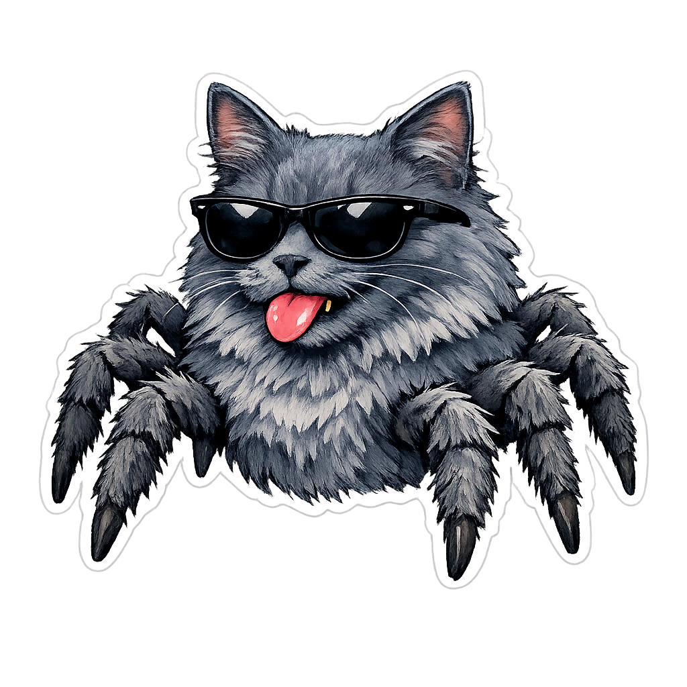

[](LICENSE)
[](https://python.org)
[](https://core.telegram.org/bots)
[-orange)](https://github.com/SYSTRAN/faster-whisper)
[]()



<ul id="user-content-toc"><summary><h1>Antigravity Agent 😸+🕷️</h1></summary></ul>

A simple Hermes-Agent copy using Google
$\textsf{\textbf{\textcolor{#FF5555}{A}\textcolor{#FF79C6}{n}\textcolor{#BD93F9}{t}\textcolor{#8BE9FD}{i}\textcolor{#50FA7B}{g}\textcolor{#F1FA8C}{r}\textcolor{#FFB86C}{a}\textcolor{#FF5555}{v}\textcolor{#FF79C6}{i}\textcolor{#BD93F9}{t}\textcolor{#8BE9FD}{y}\ \textcolor{#50FA7B}{C}\textcolor{#F1FA8C}{L}\textcolor{#FFB86C}{I}}}$<br>
as main engine.

<br>⭐️ **Why did I do this project?** Because I’m a broke university student who wants to have my own agent using my [Google One student offer](https://support.google.com/googleone/answer/17422238?hl=en). And because I liked the film *Spider-Man: Brand New Day* and I want my own 24/7 assistant, just like Peter 🕷️.

**Some features**:

+ 💬 Use of $\textsf{\textbf{\textcolor{#24A1DE}{Telegram}}}$
+ 🗣️ Local speech-to-text
+ 🧠 Power of **AGY**

## ✅️ Prerequisites

- **Linux OS** (Ubuntu 22.04+ or Debian-based distribution recommended)
- **Python 3.10+**
- **uv** package manager (`curl -LsSf https://astral.sh/uv/install.sh | sh`)
- **Google Antigravity CLI (`agy`):** installed and authenticated in `~/.local/bin` or available in `PATH`. [Install here](https://antigravity.google/product/antigravity-cli)
- **ffmpeg** (required for processing Telegram voice notes): `sudo apt install ffmpeg`

## ⤵️ Installation

Clone the repository and run the automated setup script:

```bash
git clone https://github.com/PilotLeoYan/jarvis-antigravity-agent.git
cd jarvis-antigravity-agent
chmod +x setup.sh
./setup.sh
```

## ⚙️ Configuration

Copy the example configuration file:

```bash
cp config.example.yaml config.yaml
```

Edit `config.yaml` to specify:

+ Telegram Bot token: `bot_token: "123456789:ABCdefGhIJKlmNoPQRsTUVwxyZ"`
+ Authorized users IDs: `allowed_users: - 123456789`
+ Working directory: `working_dir: "/home/username"`

## 🔄 Running as a Systemd Service

When using the automated installer (`./setup.sh`), the service file is automatically copied to `~/.config/systemd/user/agy-telegram.service` and the required entrypoint binaries are linked into `~/.local/bin/`.

To enable and run Jarvis continuously as a background daemon:

```bash
systemctl --user enable --now agy-telegram.service
```

To reload and start the service on your system:
```bash
systemctl --user daemon-reload
systemctl --user restart agy-telegram.service
systemctl --user status agy-telegram.service
```

Inspect service logs with:

```bash
journalctl --user -u agy-telegram.service -f
```

## 🚮 Uninstallation & Cleanup

To stop the background daemon and safely uninstall the agent:

```bass
./uninstall.sh
```

- `--purge-personal`: Removes personal configuration files (`config.yaml`), `state.json`, credentials, and voice caches.
- `--purge-agy`: Removes Google Antigravity application data (`~/.gemini`, `~/.agents`, `~/.config/Antigravity`).
- `--all`: Completely removes the systemd daemon, personal files, and all AGY data.
- `--dry-run`: Simulates the uninstallation without making any filesystem or daemon changes.
- `-y`, `--yes`: Non-interactive mode (proceed without confirmation prompts).

## 🎟️ Contribution

I’m just a student who undertook this project because I’ve got a lot on my plate; any [☉ Issues](https://github.com/PilotLeoYan/jarvis-antigravity-agent/issues) or [🔃 PRs](https://github.com/PilotLeoYan/jarvis-antigravity-agent/pulls) are welcome.

<a href="https://www.star-history.com/?repos=pilotleoyan%2Fjarvis-antigravity-agent&type=date&legend=top-left">
 <picture>
   <source media="(prefers-color-scheme: dark)" srcset="https://api.star-history.com/chart?repos=pilotleoyan/jarvis-antigravity-agent&type=timeline&theme=dark&legend=top-left" />
   <source media="(prefers-color-scheme: light)" srcset="https://api.star-history.com/chart?repos=pilotleoyan/jarvis-antigravity-agent&type=timeline&legend=top-left" />
   
 </picture>
</a>
