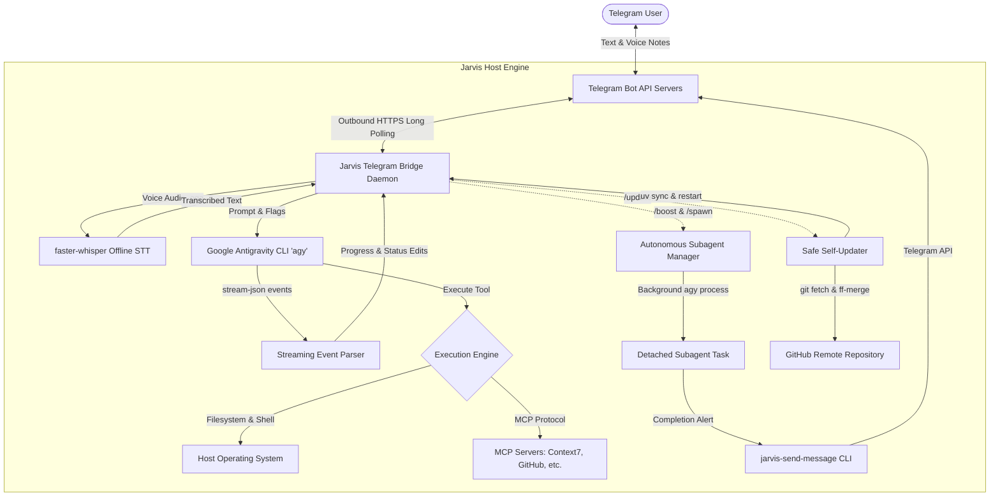

<p align="center">
  
</p>

# Jarvis Antigravity Agent

## What is the Project?

**Jarvis Antigravity Agent** is an autonomous AI assistant inspired by the architecture of Hermes-Agent, powered exclusively by **Google Antigravity CLI (`agy`)** as its reasoning engine.

The system connects the local execution capabilities of `agy` to **Telegram** via an outbound HTTPS long-polling bridge. It includes private offline speech-to-text transcription via local Whisper, autonomous background subagent dispatching, Model Context Protocol (MCP) tool management, and an automated continuous self-updating mechanism that keeps running instances up to date without overwriting local configurations or personal files.

---

## How It Works



---

## Installation

### Prerequisites

- **Linux OS** (Ubuntu 22.04+ or Debian-based distribution recommended)
- **Python 3.10+**
- **uv** package manager (`curl -LsSf https://astral.sh/uv/install.sh | sh`)
- **Google Antigravity CLI (`agy`)** installed and authenticated in `~/.local/bin` or available in `PATH`
- **ffmpeg** (required for processing Telegram voice notes):
  ```bash
  sudo apt install ffmpeg
  ```

### Automated Setup

Clone the repository and run the automated setup script:

```bash
git clone https://github.com/PilotLeoYan/jarvis-antigravity-agent.git
cd jarvis-antigravity-agent
chmod +x setup.sh
./setup.sh
```

### Manual Installation

If you prefer installing dependencies manually with `uv`:

```bash
uv sync
```

To link the executable entrypoints (`jarvis-antigravity-agent`, `jarvis-send-message`, etc.) into `~/.local/bin`:

```bash
make install
# Or manually create symlinks:
mkdir -p ~/.local/bin
ln -sf "$(pwd)/.venv/bin/jarvis-antigravity-agent" ~/.local/bin/
ln -sf "$(pwd)/.venv/bin/jarvis-send-message" ~/.local/bin/
ln -sf "$(pwd)/.venv/bin/jarvis-spawn-agent" ~/.local/bin/
ln -sf "$(pwd)/.venv/bin/jarvis-mcp" ~/.local/bin/
ln -sf "$(pwd)/.venv/bin/jarvis-update" ~/.local/bin/
ln -sf "$(pwd)/.venv/bin/jarvis-uninstall" ~/.local/bin/
```

This ensures the entrypoints are accessible in your `$PATH` and available for the systemd service daemon:
- `jarvis-antigravity-agent` (Telegram bridge daemon)
- `jarvis-send-message` (CLI alert notifier)
- `jarvis-spawn-agent` (autonomous subagent runner)
- `jarvis-mcp` (MCP server manager)
- `jarvis-update` (safe self-updater)
- `jarvis-uninstall` (safe uninstaller)

---

## Configuration

### 1. Configuration File (`config.yaml`)

Copy the example configuration file:

```bash
cp config.example.yaml config.yaml
```

Edit `config.yaml` to specify your Telegram Bot token, authorized user ID, and desired model:

```yaml
telegram:
  # Bot token obtained from @BotFather
  bot_token: "123456789:ABCdefGhIJKlmNoPQRsTUVwxyZ"
  # Allowed Telegram user IDs (whitelist)
  allowed_users:
    - 123456789
  # Default Chat ID for notifications
  default_chat_id: 123456789

agy:
  # Specific model version passed via --model flag to agy
  model: "Gemini 3.1 Pro (High)"
  # Working directory where agy commands execute
  working_dir: "/home/username"
  # Path to the agy binary
  agy_path: "agy"
  # Flags passed to agy for autonomous execution
  default_flags:
    - "--dangerously-skip-permissions"

whisper:
  model_size: "base"
  device: "cpu"
  compute_type: "int8"

mcp:
  config_path: "~/.gemini/config/mcp_config.json"

update:
  remote: "origin"
  branch: "main"
  auto_restart: true
```

### 2. Environment Variables (Alternative)

Key parameters can also be configured via environment variables:

```bash
export TELEGRAM_BOT_TOKEN="your_token_here"
export TELEGRAM_CHAT_ID="your_chat_id_here"
export AGY_MODEL="Gemini 3.1 Pro (High)"
export MCP_CONFIG_PATH="$HOME/.gemini/config/mcp_config.json"
```

### 3. Running as a Systemd Service

When using the automated installer (`./setup.sh`), the service file is automatically copied to `~/.config/systemd/user/agy-telegram.service` and the required entrypoint binaries are linked into `~/.local/bin/`.

To enable and run Jarvis continuously as a background daemon:

```bash
systemctl --user enable --now agy-telegram.service
```

If configuring manually without `setup.sh`:

```bash
mkdir -p ~/.config/systemd/user
cp systemd/agy-telegram.service ~/.config/systemd/user/
systemctl --user daemon-reload
systemctl --user enable --now agy-telegram.service
```

Inspect service logs with:

```bash
journalctl --user -u agy-telegram.service -f
```

#### Troubleshooting: `status=203/EXEC` (No such file or directory)

If `agy-telegram.service` exits with `code=exited, status=203/EXEC`:
```text
agy-telegram.service: Failed to locate executable ~/.local/bin/jarvis-antigravity-agent: No such file or directory
agy-telegram.service: Failed at step EXEC spawning ~/.local/bin/jarvis-antigravity-agent: No such file or directory
```
This indicates the executable link in `~/.local/bin/` is missing or unlinked. Fix it by running:
```bash
./setup.sh
# or
make install
```
Both `./setup.sh` and `make install` automatically:
1. Synchronize project dependencies into the virtual environment (`.venv/bin`).
2. Symlink all CLI entrypoints into `~/.local/bin/` and apply executable permissions (`chmod +x`).
3. Deploy `systemd/agy-telegram.service` to `~/.config/systemd/user/agy-telegram.service` with start burst rate limiting (`StartLimitIntervalSec=300`, `StartLimitBurst=5`) and `RestartPreventExitStatus=203` to prevent runaway restart loops if the executable is ever missing.
4. Reload the user systemd daemon (`systemctl --user daemon-reload`).

---

## Uninstallation & Cleanup

To stop the background daemon and safely uninstall the agent:

```bash
# Interactive uninstaller (prompts for confirmation)
./uninstall.sh

# Or via installed CLI entrypoint
jarvis-uninstall
```

### Cleanup Flags:
- `--purge-personal`: Removes personal configuration files (`config.yaml`), `state.json`, credentials, and voice caches.
- `--purge-agy`: Removes Google Antigravity application data (`~/.gemini`, `~/.agents`, `~/.config/Antigravity`).
- `--all`: Completely removes the systemd daemon, personal files, and all AGY data.
- `--dry-run`: Simulates the uninstallation without making any filesystem or daemon changes.
- `-y`, `--yes`: Non-interactive mode (proceed without confirmation prompts).
